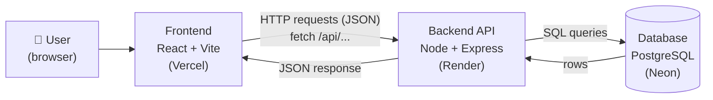
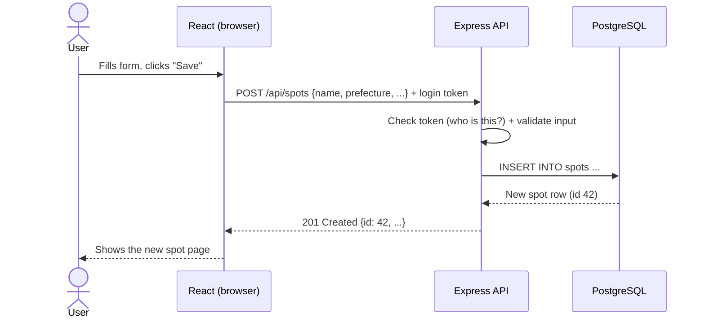
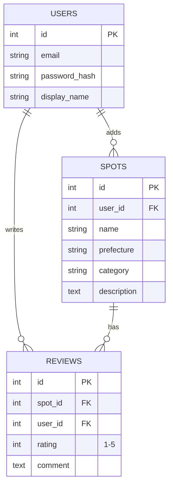
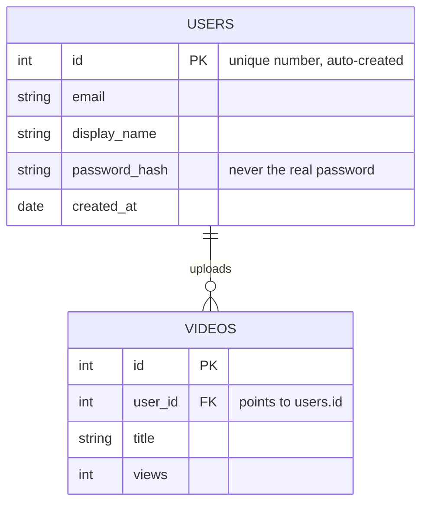

# Architecture

> Before reading: try drawing it yourself first. How does a spot get from a user's browser into the database and back?

## Big picture



## What each part does

| Part | Job | Example |
|---|---|---|
| Frontend | Shows pages, forms, handles clicks | Spot list page, "Add spot" form |
| Backend API | Rules + security: checks login, validates input, talks to DB | `POST /api/spots` checks the user is logged in, saves the spot |
| Database | Stores data permanently | users, spots, reviews tables |

## One request, step by step: "Add a spot"



## Data model (draft, Ryan to refine in Issue #4)



## How tables connect: an example

A simplified, made-up example in the style of YouTube (their real database isn't public).



**users**
| id (PK) | email | display_name | password_hash | created_at |
|---|---|---|---|---|
| 1 | ryan@mail.com | Ryan | $2b$10$Xk9... | 2026-11-08 |
| 2 | resty@mail.com | Resty | $2b$10$Pq3... | 2026-11-08 |

**videos**
| id (PK) | user_id (FK → users.id) | title | views |
|---|---|---|---|
| 101 | **1** | Hidden ramen in Gunma | 520 |
| 102 | **1** | Osaka street food | 1,200 |
| 103 | **2** | Kyoto temples | 300 |

What to notice:
- **Primary key (PK):** `id` is unique for every row, so each row can be found exactly.
- **Foreign key (FK):** `videos.user_id` stores the id of the owner. Videos 101 and 102 have `user_id = 1`, so they belong to Ryan.
- **One-to-many:** one user can have many videos, but each video has one owner.
- **Passwords** are stored only as a bcrypt hash, never as plain text.
- Real apps often use long random IDs (YouTube channel IDs look like `UC_x5XG1OV2P6uZZ5FSM9Ttw`) so they can't be guessed.

**In our app:** swap videos for **spots**. Reviews connect to *two* tables: each review has a `user_id` (who wrote it) and a `spot_id` (which spot it's about).

## Repo layout (from Sprint 1)

```
japan-hidden-spots/
├── client/     React app (frontend)
├── server/     Express API (backend)
└── docs/       Playbook, architecture
```
