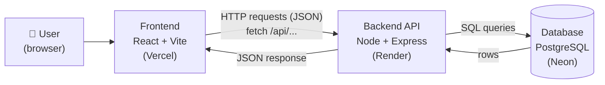
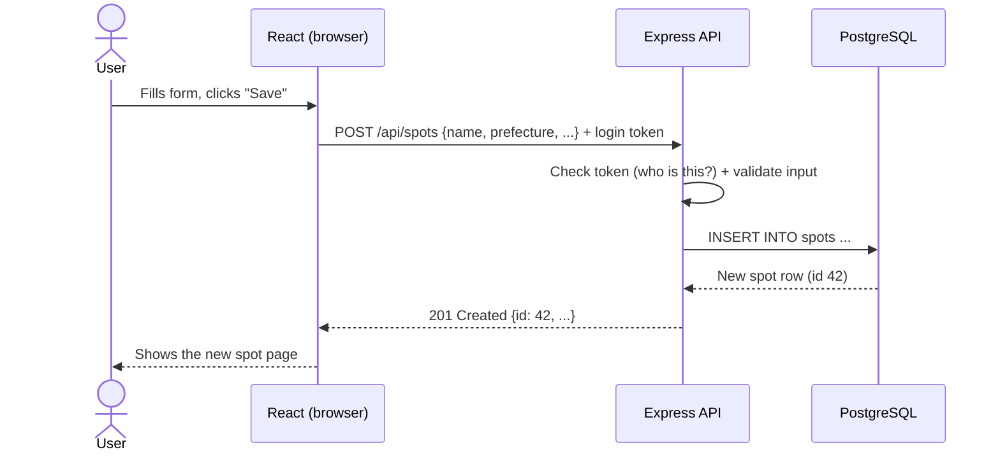
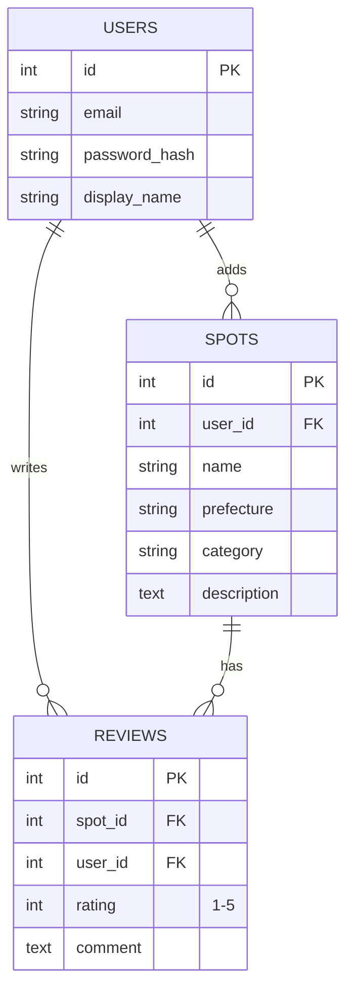

# Architecture

> Before reading: try drawing it yourself first. How does a spot get from a user's browser into the database and back?

## Big picture



## What each part does

| Part | Job | Example |
|---|---|---|
| Frontend | Shows pages, forms, handles clicks | Spot list page, "Add spot" form |
| Backend API | Rules + security: checks login, validates input, talks to DB | `POST /api/spots` checks the user is logged in, saves the spot |
| Database | Stores data permanently | users, spots, reviews tables |

## One request, step by step: "Add a spot"



## Data model (draft, Ryan to refine in Issue #4)



## Repo layout (from Sprint 1)

```
japan-hidden-spots/
├── client/     React app (frontend)
├── server/     Express API (backend)
└── docs/       Playbook, architecture
```
